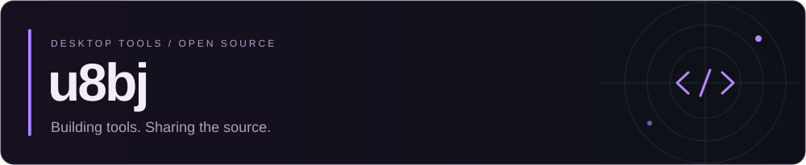
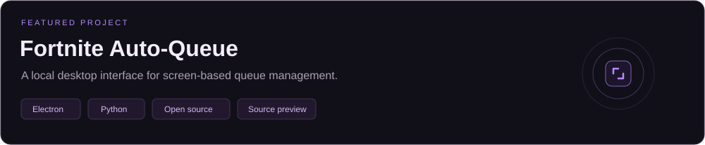
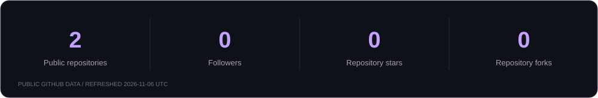

  

## Hi, I'm u8bj.

I build and share free, open-source desktop tools. My current project is **Fortnite Auto-Queue** — an Electron interface with a Python screen-recognition engine.

I like clean interfaces, practical automation and projects people can inspect, customize and run themselves.

  
  
  

---

## What I build with

  
  
  
  
  
  
  
  
  

## Featured project

**[Explore the source](https://github.com/u8bj/Fortnite-AutoQueue)** · **[Get the preview](https://github.com/u8bj/Fortnite-AutoQueue/releases)** · **[Setup guide](https://github.com/u8bj/Fortnite-AutoQueue#getting-started)** · **[Report an issue](https://github.com/u8bj/Fortnite-AutoQueue/issues)**

- A violet-and-black interface with an animated key screen and local UI sounds.
- Python screen recognition connected to Electron through a restricted local bridge.
- Ready-up, Battle Bus jumping, match/spectating monitoring and return-to-lobby handling.
- German templates included — capture replacements only if recognition fails on your setup.
- Free source preview, started with `npm start`. The shared local key is `u8bj`.

The project is experimental, independent of Epic Games and does not guarantee protection from account penalties. Its source code is MIT licensed; game assets retain their respective ownership.

## GitHub at a glance

These cards use real public GitHub data and show their last refresh date. The native contribution graph below this README is maintained by GitHub.

## Currently working on

- Testing and improving the Fortnite Auto-Queue desktop preview.
- Refining the interface, setup documentation and recognition workflow.
- Keeping the project open and easy to inspect or customize.

## Find my work

**[All repositories](https://github.com/u8bj?tab=repositories)** · **[Latest downloads](https://github.com/u8bj/Fortnite-AutoQueue/releases)** · **[Project discussions and feedback](https://github.com/u8bj/Fortnite-AutoQueue/issues)**

---

Built to be used. Shared to be improved.

